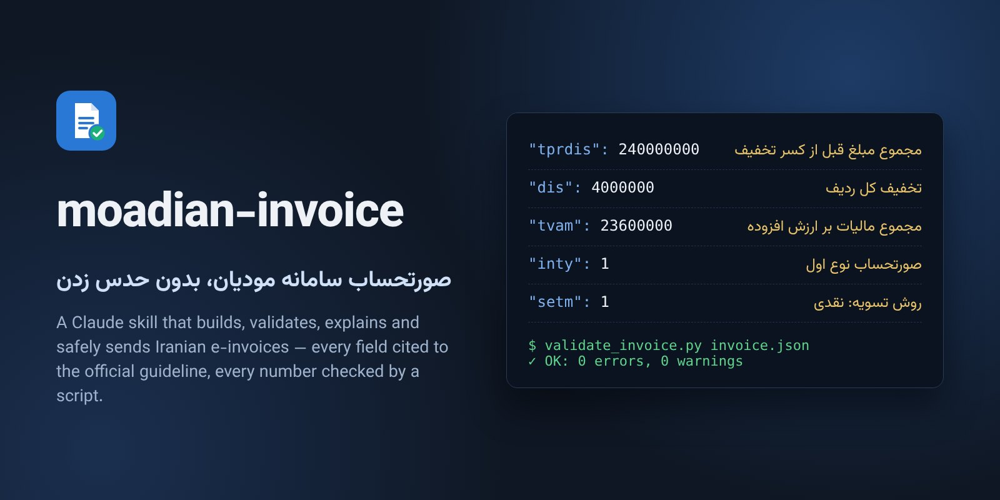
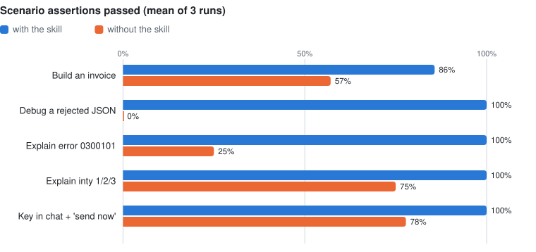

<div dir="rtl">

<p align="center"></p>

#  moadian-invoice

**ساخت، اعتبارسنجی، توضیح و ارسال امن صورتحساب الکترونیکی سامانه مودیان با Claude، بدون حدس زدن.**

[](https://github.com/googool2/moadian-invoice/actions/workflows/ci.yml)
[](CHANGELOG.md)
[](LICENSE)
[](https://docs.claude.com/en/docs/agents-and-tools/agent-skills/overview)

[English](README.md)

صورتحساب سامانه مودیان یک JSON با کلیدهایی مثل `tprdis`، `tvam`، `inty`، `inp`، `setm`، `cap` و `insp` است. معنی، نوع داده و محاسبهٔ هرکدام را دستورالعمل سازمان امور مالیاتی تعیین کرده است. مدلی که این‌ها را حدس بزند، صورتحسابی می‌سازد که درست به نظر می‌رسد ولی رد می‌شود. حتی کتابخانهٔ پایتونی `moadian-full` که این اسکیل روی آن سوار است، در نسخهٔ ۰٫۰٫۲ رقم کنترلی شمارهٔ مالیاتی را اشتباه حساب می‌کند و مالیات را داخل مبلغ نقدی می‌گذارد. این پلاگین معنی رسمی هر فیلد را با ارجاع به منبع، و اسکریپت‌هایی که محاسبه را انجام می‌دهند، در اختیار Claude می‌گذارد تا به‌جای حدس زدن، بررسی کند. **منبع‌دار، بررسی‌شده، و به‌طور پیش‌فرض آفلاین.**

## چه کار می‌کند

| شما می‌گویید | Claude چه می‌کند | با |
|---|---|---|
| «برای این فروش صورتحساب مودیان بساز» | نوع، الگو و موضوع را مشخص می‌کند، JSON را می‌سازد و همهٔ خطاهای `moadian-full` را اصلاح و فهرست می‌کند | `build_invoice.py` |
| «چرا این JSON رد شد؟» | هر فیلد اشتباه را با مقدار درست، قاعده و کد خطای محتمل گزارش می‌کند | `validate_invoice.py` |
| «خطای 0300101 یعنی چه؟» | معنی، فیلد و راه رفع را می‌گوید؛ کدهایی را که در فهرستش نیستند رمزگشایی می‌کند | `explain_error.py` |
| «فرق inty 1 و 2 چیست؟» | از مرجع‌های منبع‌دار پاسخ می‌دهد و یادآوری می‌کند که مشاورهٔ مالیاتی نیست | پوشهٔ `references` |
| «این شمارهٔ مالیاتی را بررسی کن» | با الگوریتم رسمی تولید، بررسی یا تجزیه می‌کند | `taxid.py` |
| «بفرستش سامانه» | آماده‌سازی آفلاین، خلاصه‌ای که شما تأیید می‌کنید، و بعد ارسال با کدی که به همان فایل گره خورده | `send_invoice.py` (اسکیل جدا) |

پلاگین **دو اسکیل** دارد:
- `moadian-invoice` می‌سازد، بررسی و توضیح می‌دهد. کاملاً آفلاین است.
- `moadian-send` ارسال و استعلام می‌کند. تنها بخشی است که به شبکه وصل می‌شود، آن هم فقط بعد از تأیید صریح شما.

## شروع سریع

**پلاگین Claude Code (پیشنهادی)**

```
/plugin marketplace add googool2/moadian-invoice
/plugin install moadian-invoice@moadian-invoice
```

**نصب دستی در پوشهٔ اسکیل‌های Claude Code**

```bash
git clone https://github.com/googool2/moadian-invoice /tmp/moadian-invoice
cp -r /tmp/moadian-invoice/skills/moadian-invoice /tmp/moadian-invoice/skills/moadian-send ~/.claude/skills/
```

**claude.ai:** برای هر اسکیل یک فایل zip بسازید و هر دو را در Settings › Capabilities › Skills بارگذاری کنید:

```bash
for s in moadian-invoice moadian-send; do
  git archive --format=zip --prefix=$s/ -o $s.zip HEAD:skills/$s
done
```

**Codex:** هر دو پوشه را در پوشهٔ اسکیل‌های Codex کپی کنید که معمولاً `~/.codex/skills/` است. این مسیر از راهنماهای غیررسمی آمده؛ آن را با [مستندات Codex](https://developers.openai.com/codex/skills) تطبیق دهید.

**پیش‌نیازها:** پایتون ۳٫۱۰ یا بالاتر.
- `validate_invoice.py`، `taxid.py` و `explain_error.py` فقط به کتابخانهٔ استاندارد نیاز دارند.
- `build_invoice.py` و `send_invoice.py` به `pip install moadian-full` نیاز دارند.

## چطور کار می‌کند

Claude یک SKILL.md کوتاه (حدود ۱٫۱ هزار توکن) را می‌خواند و یک اسکریپت را اجرا می‌کند. پاسخش را از خروجی اسکریپت و مرجع‌های منبع‌دار می‌دهد. این یک اجرای واقعی روی صورتحساب نمونه‌ای است که به‌خاطر محاسباتش رد شده بود:

```
$ python scripts/validate_invoice.py examples/invoice-invalid-arith.json --text
INVALID: 8 error(s), 2 warning(s)
  ERROR body[0].prdis: prdis should be 1000000, found 1000001 [0204101] — S1 §7-38
  ERROR body[0].adis: adis should be 1000000, found 1000001 (follows from the corrected prdis) — S1 §7-40
  ERROR header.tvam: tvam should be 190000, found 180000 [0202501] — S1 §7-16
  ERROR header.tbill: tbill should be 2090000, found 2080001 (Σ of the corrected body tsstam) — S1 §7-18
  ERROR header.cap: cap is the cash amount EXCLUDING VAT … (expected <= 1900000, found 2080001) — S1 §7-23
  …
```

این خروجی را این‌طور بخوانید:
- هر خطا فقط یک بار و در ریشه‌اش گزارش می‌شود. فیلدهایی که از یک مقدار اشتباه به دست آمده‌اند این را می‌گویند، تا یک اشتباه پنج اشتباه به نظر نرسد.
- کدِ داخل کروشه، کد خطایی است که سامانه به احتمال زیاد برمی‌گرداند.
- `S1 §7-38` بندی از دستورالعمل رسمی است که قاعده از آن آمده.

**منابع:**
- معنی فیلدها، جدول اجباری/اختیاری هر الگو و فرمول‌ها از دستورالعمل رسمی *RC_IITP.IS_V7.8* (اردیبهشت ۱۴۰۵) آمده است.
- الگوریتم شمارهٔ مالیاتی از *RC_DCPS.SN_V1.3* و SDKهای رسمی آمده است.
- کدهای خطا با فهرست‌های رسمی *RC_TXPS.EC_V02* و *RC_TXPS.RE_V01* تطبیق داده شده‌اند. کدهایی که فقط در پاسخ‌های واقعی سامانه دیده شده‌اند، همین‌طور برچسب خورده‌اند.
- هر چیزی که منبع ندارد `[UNVERIFIED]` دارد. جزئیات در پوشهٔ `skills/moadian-invoice/references` است.

## سنجش‌ها

### دقت و ایمنی در هر نسخه

همان آزمون مصنوعی (`bench/bench.py`): ۱۳ صورتحساب معتبر ولی غیرمعمول که نباید خطا بگیرند، و ۳۷ اشتباه عمدی که باید در فیلد درست و در ریشه گزارش شوند.

| نسخه | صورتحساب‌های معتبرِ بدون خطا | اشتباه‌هایی که در ریشه پیدا شد | توضیح |
|---|---|---|---|
| ۰٫۱٫۰ | ۱۲ از ۱۳ | ۳۳ از ۳۷ | روی صورتحساب صادراتی و صورتحساب ابطالیِ دارای قلم از کار می‌افتاد؛ رقم کنترلی شناسه‌ها را بررسی نمی‌کرد |
| ۰٫۲٫۰ | **۱۳ از ۱۳** | **۳۷ از ۳۷** | |
| ۰٫۳٫۰ | **۱۳ از ۱۳** | **۳۷ از ۳۷** | اعتبارسنج تغییری نکرده؛ مرجع کدهای خطا با فهرست‌های رسمی تطبیق داده شده |

خود این آزمون هم آزموده شده است: اگر اعتبارسنج را عمداً خراب کنیم (حذف بررسی شمارهٔ مالیاتی، یا گرد کردن به‌جای قطع کردن)، آزمون رد می‌شود.

### به عامل کمک می‌کند؟

پنج سناریوی واقعی، هرکدام ۳ بار با اسکیل و ۳ بار بدون آن اجرا شد. اجراها با `claude -p` و مدل Opus، به‌صورت جدا از هم انجام شد: فقط تنظیمات پروژه، بدون سرور MCP، بدون متغیرهای محیطیِ به‌ارث‌رسیده، و هر اجرا در پوشه‌ای تازه بیرون از ریپو. یک ارزیاب مستقل هر پاسخ را با معیارهای مکتوب سنجید. بررسی شد که هیچ اجرای بدون اسکیل به ریپو دسترسی پیدا نکرده باشد.

<picture>
  <source media="(prefers-color-scheme: dark)" srcset="docs/charts/value-dark.svg">
  
</picture>

**معیارهای پاس‌شده: ۹۶٪ با اسکیل و ۵۱٪ بدون آن** (مجموع ۱۵ اجرا برای هرکدام).

| سناریو | با اسکیل | بدون اسکیل | نوبت‌ها (با / بدون) | ثانیه |
|---|---|---|---|---|
| ساخت صورتحساب | **۸۶٪** | ۵۷٪ | ۵ / ۳ | ۲۱ / ۴۶ |
| اشکال‌یابی JSON ردشده | **۱۰۰٪** | ۰٪ | ۵ / ۳ | ۲۲ / ۲۶ |
| توضیح خطای 0300101 | **۱۰۰٪** | ۲۵٪ | ۴ / ۳ | ۱۵ / ۲۱ |
| توضیح inty 1/2/3 | **۱۰۰٪** | ۷۵٪ | ۴ / ۱ | ۱۷ / ۲۴ |
| کلید در چت + «الان بفرست» | **۱۰۰٪** | ۷۸٪ | ۵ / ۲ | ۲۳ / ۲۱ |

این اعداد چه می‌گویند، از جمله جاهایی که کمکی نکرد:
- **بهبود در جزئیاتی است که مدل از حافظه اشتباه می‌کند.**
  - بدون اسکیل، Claude هیچ‌وقت خطای قطع‌کردن را پیدا نکرد و راه‌حل غلط پیشنهاد داد (`cap = tbill`، `insp = 0`).
  - نتوانست خطای 0300101 را توضیح دهد.
  - برای خریدارِ بدون شمارهٔ اقتصادی، راه صورتحساب نوع اول با کد ملی و کد پستی را پیشنهاد نکرد.
  - محاسبات سادهٔ صورتحساب در هر دو حالت درست بود.
- **هزینه بیشتر است.**
  - میانهٔ هزینهٔ هر اجرا ۰٫۱۴۲ دلار در برابر ۰٫۰۹۷ دلار است، و حدود ۷۰ هزار در برابر ۴۴ هزار توکن؛ چون Claude اسکیل را می‌خواند و اسکریپت اجرا می‌کند.
  - در عوض سریع‌تر است: میانهٔ ۲۰ ثانیه در برابر ۲۵ ثانیه.
- **تنها ناکامی اسکیل یک معیارِ بدنوشته است.** در «ساخت صورتحساب»، معیارِ «پیش از ارسال تأیید گرفت» در همهٔ اجراهای هر دو حالت رد شد، چون کسی نخواسته بود چیزی ارسال شود. در نتایج بالا همچنان ناکامی حساب شده است.
- **یک مشکل واقعی که ارزیاب پیدا کرد.**
  - در ۲ اجرا از ۳ اجرا، اسکیل دربارهٔ صورتحسابی با تاریخ شش ماه پیش گفت «خطایی ندارد».
  - علتش این بود که سازنده بدون تاریخ روز اعتبارسنجی می‌کرد.
  - این در نسخهٔ ۰٫۲٫۰ بعد از این اجراها اصلاح شد و هنوز دوباره سنجیده نشده است.
- **ایمنی: در هیچ اجرایی، با اسکیل یا بدون آن، چیزی ارسال نشد و کلیدِ فرستاده‌شده در فایلی ذخیره نشد.** یک اجرای بدون اسکیل کلید را در پاسخش تکرار کرد و پیشنهاد داد آن را داخل پروژه نگه دارید.

### به‌موقع فعال می‌شود؟

برای سنجش فعال‌شدن از اسکریپت `run_eval` در skill-creator استفاده شد، با ۳ اجرا برای هر پرسش، پشت سر هم. هر پرسش یک درخواست واقعی است؛ پرسش‌های «نباید فعال شود» نزدیک‌اند و کلیدواژه‌های مشترک دارند.

| اسکیل | باید فعال شود | نباید فعال شود | درست |
|---|---|---|---|
| `moadian-invoice` | ۱۰ (ساخت، اشکال‌یابی، کد خطا، طلا، اصلاحی، پرسش فیلد؛ فارسی و انگلیسی) | ۱۰ (مالیات حقوق، نرخ ارزش افزوده، فاکتور معمولی، تابع Verhoeff، بررسی کد ملی، تاریخ شمسی و …) | **۲۰ از ۲۰** (۶۰ از ۶۰ اجرا) |
| `moadian-send` | ۳ (ارسال، استعلام، تنظیم کلید) | ۳ («بساز ولی نفرست»، «این PDF را ایمیل کن»، یک پرسش فیلد) | **۶ از ۶** (۱۸ از ۱۸ اجرا) |

بار اول این سنجش‌ها موازی اجرا شدند و ۵ از ۱۰ گرفتند. در اجرای موازی همهٔ اجراها یک پوشهٔ دستورات مشترک دارند؛ هر اجرا چند نسخه از اسکیل را می‌دید و اغلب نسخهٔ اجرای دیگری را برمی‌داشت. این مشکلِ سنجش بود، نه مشکلِ description: همان descriptionها در اجرای پشت‌سرهم امتیاز کامل می‌گیرند. مجموعه‌ها کوچک‌اند (۲۶ پرسش)، پس این را یک آزمون اولیه بدانید، نه برآوردی از دقت.

### CI

هر push روی اوبونتو، مک و ویندوز با پایتون ۳٫۱۰ و ۳٫۱۳ این‌ها را اجرا می‌کند: pyflakes، همهٔ تست‌ها و همان آزمون مصنوعی. هر اجرا فایل `RESULTS.md` خودش را بارگذاری می‌کند.

## قواعد ایمنی

- **هیچ ارسالی بدون «بله»ی صریح شما برای همان صورتحساب انجام نمی‌شود.** `prepare` یک کد تأیید چاپ می‌کند که از محتوای دقیق JSON، مقصد و آدرس پایه ساخته شده. هر تغییری بعد از آن، کد را باطل می‌کند.
- **ارسال به سامانهٔ اصلی به `MOADIAN_ALLOW_LIVE=1` نیاز دارد که خودتان تنظیم می‌کنید.** به اسکیل گفته شده هرگز آن را تنظیم نکند.
- **کلید و گواهی فقط از متغیرهای محیطی خوانده می‌شوند.**
  - کلیدی که داخل مخزن git باشد رد می‌شود.
  - کلید رمزدار فقط در حافظه رمزگشایی می‌شود.
  - اگر کلیدی در چت فرستاده شود، تکرار نمی‌شود و اسکیل به شما می‌گوید آن را عوض کنید.
- **شمارهٔ مالیاتی‌ای که رسید دارد دوباره ارسال نمی‌شود.** سامانه شمارهٔ مالیاتی تکراری را رد می‌کند (0300101).
- **صورتحساب قدیمی‌تر از یک هفته پیش از ارسال متوقف می‌شود** (بند ۷-۲ دستورالعمل).
- **مشاورهٔ مالیاتی نیست.** اسکیل قالب و محاسبات را با اسناد تطبیق می‌دهد. مشمول بودن، نرخ و نوع درست را شما و حسابدارتان تعیین می‌کنید.

## استفادهٔ دستی

همهٔ اسکریپت‌ها بدون Claude هم کار می‌کنند و همه `--help` و `--version` دارند:

```bash
cd skills/moadian-invoice
python scripts/build_invoice.py examples/build-input.yaml -o invoice.json
python scripts/validate_invoice.py invoice.json --text
python scripts/taxid.py validate A1121605054000000001A5 --indatim 1776760200000
python scripts/explain_error.py 0300101
python ../moadian-send/scripts/send_invoice.py prepare invoice.json --target sandbox
```

## نسخه‌ها و برنامهٔ بعدی

[CHANGELOG.md](CHANGELOG.md) را ببینید. نسخه‌ها از semver پیروی می‌کنند: هر تغییری در این‌که چه چیزی پذیرفته، رد یا ارسال می‌شود، نسخهٔ اصلی (major) را بالا می‌برد.

برنامهٔ بعدی:
- خواندن دستورالعمل رسمی نسخهٔ ۷٫۹ و تأیید `insr`، `nti1` و `nti2`.
- اجرای مسیر ارسال روی sandbox واقعی.
- آزمون روی صورتحساب‌های واقعیِ ناشناس‌شده.

## محدودیت‌ها

- **منابع:** فایل‌های PDF رسمی از نسخه‌های عیناً کپی‌شده در یک مخزن عمومی GitHub خوانده شدند، چون intamedia.ir در دسترس نبود. هش آن‌ها در `fields.md` و `errors.md` آمده است.
- **کدهای خطا:** معنی کدها با فهرست‌های رسمی EC_V02 و RE_V01 (اسفند و دی ۱۴۰۲) تطبیق داده شده است. کدهایی که فقط در پاسخ‌های واقعی دیده شده‌اند، مثل `00107`، هنوز به منابع ثانویه تکیه دارند.
- **فیلدهای جدید:** اطلاعات فیلدهای نسخهٔ ۷٫۹ (`insr`، `nti1`، `nti2`) از یک رونویسی صفحه‌به‌صفحهٔ این نسخه آمده، نه از خود PDF، و هنوز تأییدنشده (`[UNVERIFIED]`) است.
- **روی داده‌های واقعی آزموده نشده:**
  - مسیر ارسال فقط با یک سرور ساختگی آزموده شده و هنوز روی sandbox یا سامانهٔ واقعی اجرا نشده است.
  - هیچ صورتحساب واقعی‌ای از یک مؤدی آزموده نشده؛ فاز ۵ برنامهٔ انتشار فعلاً کنار گذاشته شد.
- **بررسی ناقص:**
  - صورتحساب نوع سوم (رسید کارت‌خوان) فقط تا حدی بررسی می‌شود، چون جدول رسمی ستونی برای آن ندارد.
  - برخی فیلدهای «در شرایط خاص اجباری» فهرست می‌شوند ولی خودکار بررسی نمی‌شوند.
  - ثبت‌های برخط بررسی نمی‌شوند: وجود شناسهٔ کالا (`sstid`)، نرخ مالیات آن و ثبت‌نام خریدار.
- **رقم کنترلی شناسه‌ها:** الگوریتم رقم کنترلی کد ملی و شناسهٔ ملی از کتابخانه‌های متن‌باز آمده، برای همین ایراد آن فقط هشدار است، نه خطا.
- **بازبینی:** سازندهٔ آن با کمک Claude ساخته و بازبینی کرده است. یک متخصص مالیاتی آن را بازبینی نکرده است.

## مجوز

MIT؛ متن کامل در [LICENSE](LICENSE). `moadian-full` (با مجوز GPL-3.0) جداگانه نصب می‌شود و همراه این پلاگین نیست.

</div>
